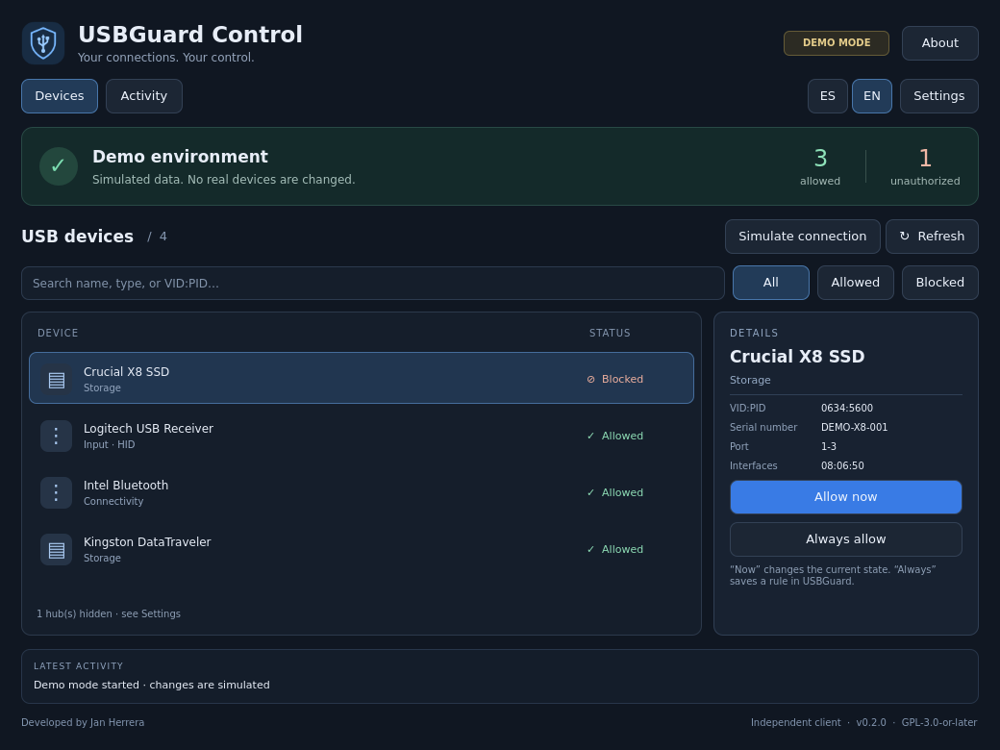

# USBGuard Control

[](https://github.com/Lupo-SysAdmin/usbguard-control/actions/workflows/ci.yml)

**A Linux desktop interface for deciding what you connect.**

UI developer: **Jan Herrera** · [Lupo-SysAdmin](https://github.com/Lupo-SysAdmin)

[Downloads](https://github.com/Lupo-SysAdmin/usbguard-control/releases) · [Español](README.md) · [Kali setup](docs/INSTALL.md) · [Architecture](docs/ARCHITECTURE.md)



An independent Python / PySide6 / Qt Quick client for USBGuard. USBGuard remains responsible for device authorization and policy enforcement. This application is not affiliated with the upstream USBGuard project.

## Status

**0.2.0 · first-release candidate.** Functional D-Bus client, Debian package and **62 passing automated tests**. Tested with physical devices on Kali 2026.3 / GNOME Shell 50.4 / Wayland, and in KVM guests running Kali 2026.1 / Xfce 4.20.3 / X11 and Parrot 7.4 / KDE Plasma 6.3.6 / Wayland. Tests cover installation/removal, service controls, authentication, reboots, recovery, reconnection and rule revocation. PySide6 versions tested: 6.8.2.1, 6.10.3 and 6.11.2. Primary daemon: USBGuard 1.1.4; Parrot's 1.1.3 API was also exercised. See [validation results and limits](docs/VALIDATION.md). Available in Latin American Spanish and US English.

## Features

- Searchable device list, authorization filters and device details.
- Instant **ES / EN** language switch with a saved preference, including existing session activity.
- Explicit temporary allow, persistent allow and temporary block actions.
- Protected HID/Bluetooth/hub handling and device identity revalidation before changes.
- D-Bus events, reconnect attempts and grouped desktop notifications.
- Session activity export (up to 200 events; not a complete audit log).
- Standalone demo with simulated hotplug and policy persistence.
- Settings with wrapped text and scrolling, explicit service start/stop, and optional startup persistence through systemd and Polkit.
- No root GUI, shell commands, direct system policy writes, or implicit service activation.

## Run

Install distribution dependencies using the [setup guide](docs/INSTALL.md), then:

```bash
PYTHONPATH=src python3 -m usbguard_control --demo --language en-US
```

Use **ES / EN** in the toolbar to switch between `es-419` and `en-US` and save your preference. `--language` overrides the language for that launch only. Hardware names are never translated. External system dialogs such as Polkit follow the desktop language.

Omit `--demo` only when USBGuard is already configured. Run as a regular user. The app relies on the existing USBGuard D-Bus bridge and its Polkit policy; it never changes permissions to bypass authentication.

In Settings, **Remember this choice at system startup** makes Start enable both USBGuard services at boot and Stop disable their automatic startup. Uncheck it to change only the current state. Every operation requires confirmation and may request desktop authentication. Current and startup states are read from systemd, including after partial failures. Masked, missing, or specially configured units require manual setup. Stopping USBGuard preserves saved rules and does not necessarily unblock connected devices. Opening or closing the app does not change the service state.

Kali's USBGuard package may start services during installation. Prepare and review initial rules to avoid disabling input devices; see the setup guide before installing the daemon.

## Validate and package

```bash
sh scripts/check.sh
python3 scripts/diagnose.py
python3 scripts/build_deb.py
```

Tests use an isolated bus and a mock service, never USB hardware. The package is written to `dist/usbguard-control_0.2.0-1_all.deb`. USBGuard is a suggested dependency, intentionally installed and configured separately. GitHub Actions runs tests and packaging on Debian for each push. See the [CI results](https://github.com/Lupo-SysAdmin/usbguard-control/actions/workflows/ci.yml).

The [validation checklist](docs/VALIDATION.md) distinguishes completed checks from pending physical and desktop-session tests.

## Credits and license

**Jan Herrera — USBGuard Control UI developer.** Copyright © 2026 Jan Herrera.

GPL-3.0-or-later. See [LICENSE](LICENSE), [AUTHORS](AUTHORS), [NOTICE](NOTICE) and the [license rationale](docs/LICENSING.md). Attribution applies to this independent interface; USBGuard, Qt, PySide6 and their dependencies retain their respective ownership and licensing. Distributed without warranty.
