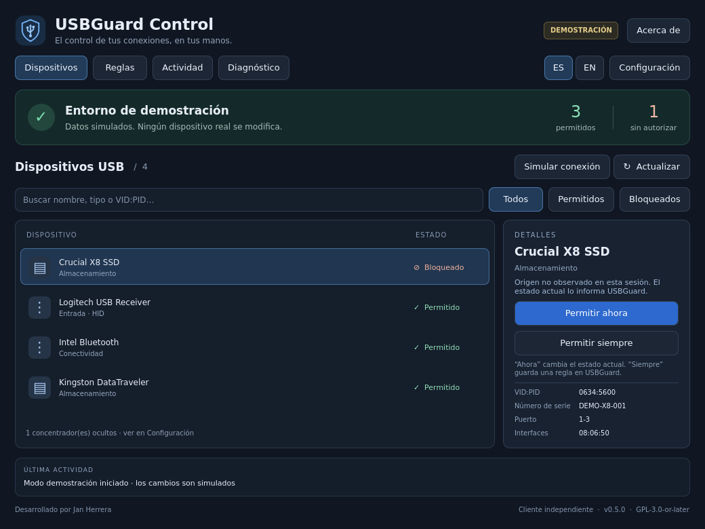

# USBGuard Control

[](https://github.com/Lupo-SysAdmin/usbguard-control/actions/workflows/ci.yml)

**Una interfaz de escritorio para decidir qué conectas a tu Linux.**

Desarrollador de la interfaz: **Jan Herrera** · [Lupo-SysAdmin](https://github.com/Lupo-SysAdmin)

[Descargar versión estable](https://github.com/Lupo-SysAdmin/usbguard-control/releases/latest) · [English](README.en.md) · [Instalación en Kali](docs/INSTALL.md) · [Arquitectura](docs/ARCHITECTURE.md) · [Licencia y créditos](docs/LICENSING.md)



USBGuard Control es un cliente independiente para [USBGuard](https://github.com/USBGuard/usbguard), construido con Python, PySide6 y Qt Quick/QML. Presenta el estado del servicio, los dispositivos USB y sus decisiones de autorización en una ventana compacta. El motor de seguridad sigue siendo USBGuard.

## Estado del proyecto

**Rama de desarrollo 0.3.0.dev1.** Incluye gestión guiada de reglas, respaldos, historial local, diagnóstico y preferencias de escritorio. La versión publicada **0.2.0 estable** sigue disponible en [Descargas](https://github.com/Lupo-SysAdmin/usbguard-control/releases/tag/v0.2.0). Esta rama no sustituye esa release ni se presenta como estable.

Las pruebas automatizadas de esta rama usan demostración y un bus D-Bus aislado. La validación física y de escritorios documentada para 0.2.0 no certifica las funciones nuevas; consulta [Desarrollo 0.3](docs/DEVELOPMENT-0.3.md) para el alcance y los límites.

Entornos probados anteriormente con 0.2.0: Kali 2026.3 con GNOME Shell 50.4/Wayland; Kali 2026.1 con Xfce 4.20.3/X11; Parrot 7.4 con KDE Plasma 6.3.6/Wayland. PySide6 6.8.2.1, 6.10.3 y 6.11.2. Motor principal probado: USBGuard 1.1.4; también se verificó la API 1.1.3 distribuida por Parrot. La aplicación no es una extensión de GNOME Shell.

## Qué incluye

- Diseño oscuro, escalable y redimensionable, con controles de teclado y estados identificados por texto e iconos.
- Selector **ES / EN**: español latinoamericano (`es-419`) e inglés estadounidense (`en-US`), cambio inmediato y preferencia guardada.
- Búsqueda por nombre, tipo o VID:PID y filtros de autorización.
- Panel de detalles con serie, puerto e interfaces USB.
- **Permitir ahora**, **Permitir siempre** y **Bloquear ahora**, con confirmación y errores explícitos.
- Configuración con texto ajustado y desplazamiento; iniciar/detener los servicios y recordar la elección al arrancar mediante systemd y Polkit.
- Restricción de bloqueo para HID, adaptadores Bluetooth, concentradores y dispositivos con interfaces desconocidas.
- Eventos D-Bus, reconexión periódica y notificaciones agrupadas mientras el observador está en ejecución.
- **Reglas y confianza:** reglas activas en su orden, búsqueda, nombres personalizados incluso desconectados, edición guiada permitir/bloquear y retirada de reglas específicas.
- Vista previa con dispositivos coincidentes, revalidación de la política y respaldo local obligatorio antes de modificar reglas.
- Exportación de respaldos y recuperación selectiva de reglas específicas faltantes; las reglas protegidas y avanzadas se conservan para revisión administrativa.
- Historial local entre sesiones, retención de 7/30/90 días, búsqueda por mensaje/fecha y exportación JSON/CSV con ocultación de detalles.
- Diagnóstico de servicios/conexión/reglas, comprobación opcional del emparejamiento del iPhone y asistente inicial guiado.
- Temas claro, oscuro y del sistema; preferencias, nombres y tamaño de ventana guardados.
- Observador opcional en segundo plano, apertura desde notificaciones compatibles, instancia única e inicio de sesión opcional desde el paquete instalado.
- Modo demostración separado del sistema: permite simular desconexiones y comparar decisiones temporales con persistentes.
- Paquete `.deb` sin scripts administrativos ni instalación automática del daemon.

Los servicios solo se inician o detienen mediante una acción explícita y confirmada en Configuración. La GUI sigue ejecutándose como usuario normal, sin shell ni escritura directa de reglas; systemd y Polkit gestionan los permisos. Cerrar la ventana no desactiva USBGuard. “Servicio disponible” describe la comunicación; no certifica que todos los dispositivos sean seguros. Las políticas pueden cambiar por otros clientes, incluida la integración de GNOME.

## Ejecutar la demostración

Con las dependencias de Qt/Python instaladas (ver la [guía](docs/INSTALL.md)):

```bash
PYTHONPATH=src python3 -m usbguard_control --demo
```

Todos los nombres, números de serie y huellas del modo demostración son ficticios. Las decisiones de demostración permanecen solo durante esa ejecución.

El selector de idioma está en la barra superior. Traduce controles, estados, confirmaciones, errores propios, notificaciones e incluso los eventos ya registrados. Conserva intactos los nombres e identificadores del hardware. La elección se guarda mediante QSettings en la configuración del usuario. Puedes iniciar una sesión concreta con `--language en-US` o `--language es-419`; ese argumento no sobrescribe por sí solo la preferencia guardada. Los diálogos externos del sistema, como Polkit, siguen el idioma del escritorio.

Para usar un servicio USBGuard **ya configurado**, como usuario normal:

```bash
PYTHONPATH=src python3 -m usbguard_control
```

No inicies USBGuard por primera vez sin revisar la política y un mecanismo de recuperación. El paquete oficial de Kali puede iniciar los servicios durante su instalación; la guía explica cómo preparar una instalación nueva.

## Desarrollo y comprobación

```bash
sh scripts/check.sh
python3 scripts/diagnose.py
```

Las pruebas cubren el análisis de dispositivos compuestos, protección de HID/concentradores, identidades cambiadas, desconexiones, persistencia simulada, errores de autorización, señales D-Bus, el flujo QML y la selección/persistencia del idioma. La prueba D-Bus necesita permiso para crear un socket local privado; no usa el bus del sistema.

Para construir el paquete sin privilegios:

```bash
python3 scripts/build_deb.py
```

El resultado es `dist/usbguard-control_0.3.0~dev1-1_all.deb`. GitHub Actions ejecuta las pruebas y el empaquetado en Debian con cada envío. Consulta el [resultado de CI](https://github.com/Lupo-SysAdmin/usbguard-control/actions/workflows/ci.yml).

Atajos: **Ctrl+F** buscar, **Ctrl+R** actualizar, **Ctrl+Q** salir. Tab y Shift+Tab recorren los controles. Los paneles tienen desplazamiento cuando la ventana es pequeña.

## Hoja de ruta

1. **Prototipo visual:** implementado con demostración funcional y captura real de QML.
2. **Integración:** daemon/hardware reales, Polkit, recuperación, revocación y cambios externos probados; alcance detallado en la matriz de validación.
3. **Instalación:** `.deb` instalado en Kali/GNOME y ensayado con instalación/desinstalación en VMs Kali/Xfce y Parrot/KDE.
4. **Portafolio:** repositorio público con documentación bilingüe, autoría, licencia, capturas y CI. Consulta las versiones en Descargas.

Ver [plan de validación](docs/VALIDATION.md). Las nuevas funciones de esta rama requieren la validación de escritorio descrita en [Desarrollo 0.3](docs/DEVELOPMENT-0.3.md) antes de una publicación estable. El historial del observador no equivale al registro completo del servicio.

## Autoría y licencia

**Jan Herrera — desarrollador de la interfaz USBGuard Control.**

Copyright © 2026 Jan Herrera. El código de esta interfaz se distribuye bajo **GPL-3.0-or-later**. Puedes usarlo, estudiarlo, modificarlo y redistribuirlo cumpliendo la licencia, conservando los avisos aplicables y proporcionando el código fuente correspondiente cuando corresponda.

USBGuard Control es independiente y no está afiliado oficialmente al proyecto USBGuard. USBGuard, Qt, PySide6 y sus dependencias conservan sus autores y licencias. Jan Herrera no se atribuye la creación de esos proyectos. Consulta [LICENSE](LICENSE), [NOTICE](NOTICE) y [AUTHORS](AUTHORS).
