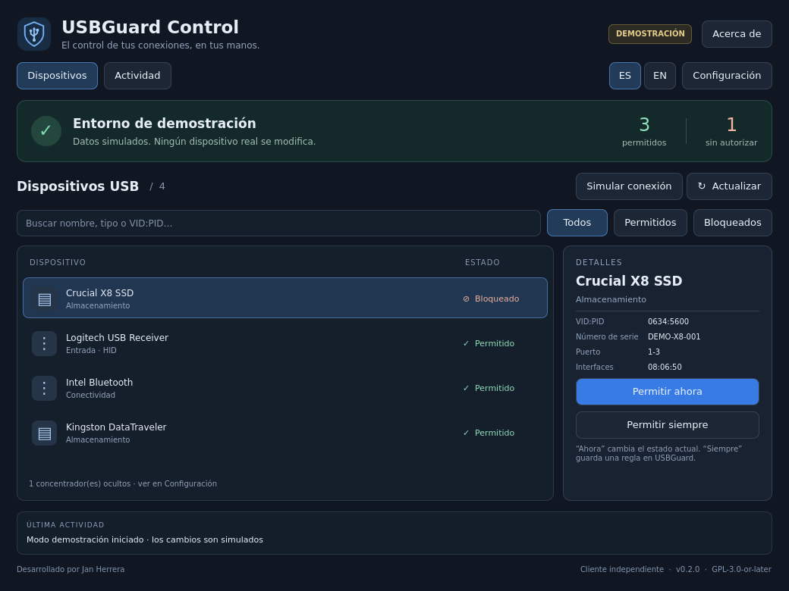

# USBGuard Control

**Una interfaz de escritorio para decidir qué conectas a tu Linux.**

Desarrollador de la interfaz: **Jan Herrera** · [Lupo-SysAdmin](https://github.com/Lupo-SysAdmin)

[English](README.en.md) · [Instalación en Kali](docs/INSTALL.md) · [Arquitectura](docs/ARCHITECTURE.md) · [Licencia y créditos](docs/LICENSING.md)



USBGuard Control es un cliente independiente para [USBGuard](https://github.com/USBGuard/usbguard), construido con Python, PySide6 y Qt Quick/QML. Presenta el estado del servicio, los dispositivos USB y sus decisiones de autorización en una ventana compacta. El motor de seguridad sigue siendo USBGuard.

## Estado del proyecto

**v0.1.0 · alpha**. Demostración funcional y cliente D-Bus para USBGuard 1.1.4, con pruebas aisladas y una primera validación física en Kali/GNOME: autorización temporal y persistente de un iPhone, reconexión y permiso persistente de un receptor de mouse. La matriz completa de escritorios y escenarios de recuperación sigue pendiente.

Desarrollado en Kali 2026.3, Python 3.14 y PySide6 6.10.3. La primera prueba de sesión real se realizó en GNOME Shell 50.4/Wayland; KDE Plasma, Xfce y X11 siguen pendientes. La aplicación no es una extensión de GNOME Shell.

## Qué incluye

- Diseño oscuro, escalable y redimensionable, con controles de teclado y estados identificados por texto e iconos.
- Selector **ES / EN**: español latinoamericano (`es-419`) e inglés estadounidense (`en-US`), cambio inmediato y preferencia guardada.
- Búsqueda por nombre, tipo o VID:PID y filtros de autorización.
- Panel de detalles con serie, puerto e interfaces USB.
- **Permitir ahora**, **Permitir siempre** y **Bloquear ahora**, con confirmación y errores explícitos.
- Restricción de bloqueo para HID, adaptadores Bluetooth, concentradores y dispositivos con interfaces desconocidas.
- Eventos D-Bus, reconexión periódica y notificaciones agrupadas mientras está abierta.
- Actividad de la sesión, limitada a 200 eventos, exportable a JSON.
- Modo demostración separado del sistema: permite simular desconexiones y comparar decisiones temporales con persistentes.
- Paquete `.deb` sin scripts administrativos ni instalación automática del daemon.

La interfaz no inicia ni detiene servicios, no ejecuta comandos como root y no escribe directamente las reglas del sistema. Cerrar la ventana no desactiva USBGuard. “Servicio disponible” describe la comunicación; no certifica que todos los dispositivos sean seguros. Las políticas pueden cambiar por otros clientes, incluida la integración de GNOME.

## Ejecutar la demostración

Con las dependencias de Qt/Python instaladas (ver la [guía](docs/INSTALL.md)):

```bash
PYTHONPATH=src python3 -m usbguard_control --demo
```

Todos los nombres, números de serie y huellas del modo demostración son ficticios. Las decisiones de demostración permanecen solo durante esa ejecución.

El selector de idioma está en la barra superior. Traduce controles, estados, confirmaciones, errores propios, notificaciones e incluso los eventos ya registrados. Conserva intactos los nombres e identificadores del hardware. La elección se guarda mediante QSettings en la configuración del usuario. Puedes iniciar una sesión concreta con `--language en-US` o `--language es-419`; ese argumento no sobrescribe por sí solo la preferencia guardada. Los diálogos externos del sistema, como Polkit, siguen el idioma del escritorio.

Para usar un servicio USBGuard **ya configurado**, como usuario normal:

```bash
PYTHONPATH=src python3 -m usbguard_control
```

No inicies USBGuard por primera vez sin revisar la política y un mecanismo de recuperación. El paquete oficial de Kali puede iniciar los servicios durante su instalación; la guía explica cómo preparar una instalación nueva.

## Desarrollo y comprobación

```bash
sh scripts/check.sh
python3 scripts/diagnose.py
```

Las pruebas cubren el análisis de dispositivos compuestos, protección de HID/concentradores, identidades cambiadas, desconexiones, persistencia simulada, errores de autorización, señales D-Bus, el flujo QML y la selección/persistencia del idioma. La prueba D-Bus necesita permiso para crear un socket local privado; no usa el bus del sistema.

Para construir el paquete sin privilegios:

```bash
python3 scripts/build_deb.py
```

El resultado es `dist/usbguard-control_0.1.0-1_all.deb`. Se incluye un flujo de GitHub Actions para pruebas y empaquetado. Configurarlo en el repositorio no significa que ya se haya ejecutado en GitHub.

Atajos: **Ctrl+F** buscar, **Ctrl+R** actualizar, **Ctrl+Q** salir. Tab y Shift+Tab recorren los controles. Los paneles tienen desplazamiento cuando la ventana es pequeña.

## Hoja de ruta

1. **Prototipo visual:** implementado con demostración funcional y captura real de QML.
2. **Integración:** cliente D-Bus implementado y primeras pruebas con daemon/hardware reales completadas; faltan escenarios de fallo y recuperación.
3. **Instalación:** `.deb` instalado mediante APT en Kali/GNOME; falta ensayo de instalación y desinstalación en una VM limpia y otros escritorios.
4. **Portafolio:** documentación bilingüe, autoría, licencia, captura y CI preparados; publicación y primera release pendientes.

Ver [plan de validación](docs/VALIDATION.md). Próximas mejoras: persistencia de las demás preferencias, editor de reglas con respaldo y revocación, y asistente de instalación validado. No se presenta un historial de sesión como si fuera un registro de auditoría completo.

## Autoría y licencia

**Jan Herrera — desarrollador de la interfaz USBGuard Control.**

Copyright © 2026 Jan Herrera. El código de esta interfaz se distribuye bajo **GPL-3.0-or-later**. Puedes usarlo, estudiarlo, modificarlo y redistribuirlo cumpliendo la licencia, conservando los avisos aplicables y proporcionando el código fuente correspondiente cuando corresponda.

USBGuard Control es independiente y no está afiliado oficialmente al proyecto USBGuard. USBGuard, Qt, PySide6 y sus dependencias conservan sus autores y licencias. Jan Herrera no se atribuye la creación de esos proyectos. Consulta [LICENSE](LICENSE), [NOTICE](NOTICE) y [AUTHORS](AUTHORS).
