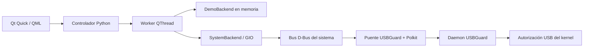

# Arquitectura

- `domain.py`: interpreta snapshots concretos de dispositivos, clasifica interfaces y valida acciones. No es un parser general para editar políticas.
- `demo.py`: simulación en memoria, sin importar GIO ni acceder al bus del sistema.
- `backend.py`: llamadas con tipos explícitos, sin shell, sin autoactivación y dirigidas al propietario único del servicio.
- `controller.py`: estado observable para QML, confirmaciones, actividad y trabajo bloqueante fuera del hilo gráfico.
- `qml/`: interfaz, componentes, navegación y diálogos.
- `translations.py` / `localization.py`: catálogos `es-419` y `en-US`, traducción Qt en caliente y preferencia de idioma en QSettings. Los eventos conservan plantillas y valores separados para cambiar el idioma sin traducir nombres de hardware.

Contrato consultado directamente en el [tag USBGuard 1.1.4](https://github.com/USBGuard/usbguard/blob/usbguard-1.1.4/src/DBus/DBusInterface.xml):

| Elemento | Valor |
|---|---|
| Nombre de servicio | `org.usbguard1` |
| Objeto de dispositivos | `/org/usbguard1/Devices` |
| Interfaz de dispositivos | `org.usbguard.Devices1` |
| Listado | `listDevices(s) → a(us)` |
| Decisión | `applyDevicePolicy(u, u, b) → u` |
| Parámetros | `/org/usbguard1`, `org.usbguard1.getParameter(s) → s` |

No usar sin comprobar los ejemplos antiguos de la web que omiten el sufijo `1`. Se solicita autenticación interactiva únicamente al aplicar una decisión; la política instalada del servicio decide si procede. El daemon serializa y persiste las reglas. La GUI no instala reglas Polkit permisivas.

GIO se ejecuta en un QThread con un contexto GLib propio; un temporizador despacha señales. Un snapshot inicial y la reconciliación cada cinco segundos cubren señales perdidas y reinicios. Los eventos se agrupan durante 900 ms antes de notificar. El servicio nunca se inicia al abrir la GUI.

Antes de cambiar un dispositivo se comprueba el propietario D-Bus y se vuelve a leer su identidad: VID:PID, serie, hash, padre, puerto e interfaces. Esto reduce errores por snapshots obsoletos. La API upstream solo acepta el ID al aplicar, por lo que no proporciona una operación atómica “comprobar identidad y cambiar”; sigue existiendo una ventana entre lectura y escritura. No se presenta el hash como prueba criptográfica de que un hardware sea confiable.

La primera versión restringe el bloqueo de cualquier interfaz HID, adaptadores Bluetooth USB (HCI `e0:01:01`), hubs y tipos desconocidos. Un teclado Bluetooth puede depender de ese adaptador aunque no aparezca como teclado USB. No ofrece rechazo, reglas arbitrarias ni un interruptor global ambiguo. El estado “permitido” describe autorización, no ausencia de malware.

El idioma se guarda en la configuración del usuario; las demás preferencias de vista y la actividad son de sesión. La GUI utiliza texto plano para nombres suministrados por USB, elimina caracteres de control al mostrarlos y no interpola nombres en comandos. Las exportaciones contienen actividad de sesión en el idioma seleccionado y pueden incluir nombres de dispositivos; no se envían a ningún servidor.
