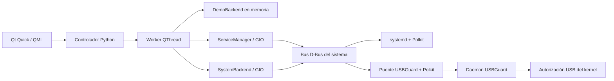

# Arquitectura

- `domain.py`: interpreta snapshots concretos de dispositivos, clasifica interfaces y valida acciones. No es un parser general para editar políticas.
- `demo.py`: simulación en memoria, sin importar GIO ni acceder al bus del sistema.
- `backend.py`: llamadas con tipos explícitos, sin shell, sin autoactivación y dirigidas al propietario único del servicio.
- `services.py`: lectura de las dos unidades USBGuard y acciones explícitas de systemd, con autenticación interactiva, comprobación de jobs y relectura del estado. La demostración usa un administrador en memoria.
- `controller.py`: estado observable para QML, confirmaciones, actividad y trabajo bloqueante fuera del hilo gráfico.
- `qml/`: interfaz, componentes, navegación y diálogos.
- `translations.py` / `localization.py`: catálogos `es-419` y `en-US`, traducción Qt en caliente y preferencia de idioma en QSettings. Los eventos conservan plantillas y valores separados para cambiar el idioma sin traducir nombres de hardware.

Contrato consultado directamente en el [tag USBGuard 1.1.4](https://github.com/USBGuard/usbguard/blob/usbguard-1.1.4/src/DBus/DBusInterface.xml):

| Elemento | Valor |
|---|---|
| Nombre de servicio | `org.usbguard1` |
| Objeto de dispositivos | `/org/usbguard1/Devices` |
| Interfaz de dispositivos | `org.usbguard.Devices1` |
| Listado | `listDevices(s) → a(us)` |
| Decisión | `applyDevicePolicy(u, u, b) → u` |
| Parámetros | `/org/usbguard1`, `org.usbguard1.getParameter(s) → s` |

No usar sin comprobar los ejemplos antiguos de la web que omiten el sufijo `1`. Se solicita autenticación interactiva al aplicar una decisión USB o un cambio explícito de servicio; las políticas instaladas deciden si procede. El daemon serializa y persiste las reglas. La GUI no instala reglas Polkit permisivas.

GIO se ejecuta en un QThread con un contexto GLib propio; un temporizador despacha señales. Un snapshot inicial y la reconciliación cada cinco segundos cubren señales perdidas y reinicios. Los eventos se agrupan durante 900 ms antes de notificar. El servicio nunca se inicia al abrir la GUI.

Antes de cambiar un dispositivo se comprueba el propietario D-Bus y se vuelve a leer su identidad: VID:PID, serie, hash, padre, puerto e interfaces. Esto reduce errores por snapshots obsoletos. La API upstream solo acepta el ID al aplicar, por lo que no proporciona una operación atómica “comprobar identidad y cambiar”; sigue existiendo una ventana entre lectura y escritura. No se presenta el hash como prueba criptográfica de que un hardware sea confiable.

La autorización de dispositivos restringe el bloqueo de cualquier interfaz HID, adaptadores Bluetooth USB (HCI `e0:01:01`), hubs y tipos desconocidos. Un teclado Bluetooth puede depender de ese adaptador aunque no aparezca como teclado USB. No ofrece rechazo, reglas arbitrarias ni un interruptor global ambiguo. El estado “permitido” describe autorización, no ausencia de malware.

El idioma, filtros, vista avanzada, notificaciones, alias, tema y tamaño de ventana se guardan en QSettings. El workspace puede conservar actividad en SQLite; la demostración utiliza memoria. La GUI utiliza texto plano para nombres suministrados por USB, elimina caracteres de control al mostrarlos y no interpola nombres en comandos. Las exportaciones contienen actividad de sesión en el idioma seleccionado y pueden incluir nombres de dispositivos; no se envían a ningún servidor.

La elección de arranque se guarda en systemd, no en QSettings: `EnableUnitFiles` o `DisableUnitFiles` persistentes y `Reload`. El controlador consulta el estado incluso si el puente USBGuard está detenido, permitiendo iniciarlo desde Configuración. Solo acepta unidades instaladas con estados de habilitación ordinarios; conserva máscaras y configuraciones especiales. Inicia primero el daemon y luego el puente; detiene primero el puente y luego el daemon. Espera cada job y comprueba el estado final antes de declarar éxito. Revalida el snapshot confirmado, pero las operaciones no son atómicas: ante un fallo parcial muestra el error y vuelve a leer ambos estados sin intentar una reversión automática. [API de systemd](https://www.freedesktop.org/software/systemd/man/latest/org.freedesktop.systemd1.html).

## Workspace 0.3

- `workspace.py`: preferencias, alias, explicaciones observadas, previews y consultas de historial.
- `policy.py`: gramática conservadora para edición guiada; las reglas desconocidas se muestran solo para consulta.
- `policy_backend.py`: operaciones de reglas con revalidación, respaldo previo y reporte explícito de cambios parciales.
- `storage.py`: escritura atómica de exportaciones, historial privado y retención.
- `desktop.py`: socket local de instancia única, indicador opcional y entrada XDG de inicio de sesión. GNOME sin bandeja permite reabrir desde el menú.
- `appearance.py` y componentes QML: paleta común para temas claro/oscuro y controles accesibles.

Se consulta `org.usbguard.Policy1` en `/org/usbguard1/Policy`: `listRules(s) → a(us)`, `appendRule(s,u,b) → u`, `removeRule(u)`. En **appendRule** el booleano significa **temporary**, al contrario del booleano **permanent** de applyDevicePolicy. Para persistir se envía `False`; esto se contrastó con [DBusBridge.cpp de 1.1.4](https://github.com/USBGuard/usbguard/blob/usbguard-1.1.4/src/DBus/DBusBridge.cpp).

Editar inserta la sustitución después de la regla original y luego retira la original, conservando la posición relativa al resto. Si la segunda operación falla, se informa el resultado parcial y se mantiene el respaldo. Recuperar añade reglas faltantes al final, sin borrar la política vigente. Estas operaciones no reautorizan los dispositivos conectados.

Las explicaciones proceden de decisiones realizadas por esta instancia o de las señales DevicePolicyApplied/Changed, contrastadas con la identidad y el estado actuales. Un snapshot inicial no se interpreta como evidencia de qué regla causó la autorización.
