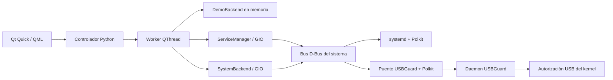

# Architecture

- `domain.py`: interprets specific snapshots of devices, classifies interfaces and validates actions. It is not a general parser for editing policies.
- `demo.py`: in-memory simulation, without importing GIO or accessing the system bus.
- `backend.py`: calls with explicit types, without shell, without autoactivation and directed to the sole owner of the service.
- `services.py`: reading of the two USBGuard units and explicit systemd actions, with interactive authentication, job verification and status rereading. The demo uses an in-memory manager.
- `controller.py`: Observable state for QML, confirmations, activity and blocking work outside of the GUI thread.
- `qml/`: interface, components, navigation and dialogs.
- `translations.py` / `localization.py`: `es-419` and `en-US` catalogs, hot Qt translation and language preference in QSettings. Events retain separate templates and values ​​to change the language without translating hardware names.

Contract consulted directly in the [tag USBGuard 1.1.4](https://github.com/USBGuard/usbguard/blob/usbguard-1.1.4/src/DBus/DBusInterface.xml):

| Element | Value |
|---|---|
| Service name | `org.usbguard1` |
| Devices object | `/org/usbguard1/Devices` |
| Device interface | `org.usbguard.Devices1` |
| Listing | `listDevices(s) → a(us)` |
| Decision | `applyDevicePolicy(u, u, b) → u` |
| Parameters | `/org/usbguard1`, `org.usbguard1.getParameter(s) → s` |

Do not use old web examples that omit the `1` suffix without checking them. Interactive authentication is requested when applying a USB decision or explicit service change; installed policies decide whether to proceed. The daemon serializes and persists the rules. The GUI does not install permissive Polkit rules.

GIO runs on a QThread with its own GLib context; a timer dispatches signals. An initial snapshot and reconciliation every five seconds covers lost signals and reboots. Events are grouped for 900 ms before notifying. The service never starts when opening the GUI.

Before changing a device, the D-Bus owner is checked and its identity is read again: VID:PID, serial, hash, parent, port and interfaces. This reduces errors due to outdated snapshots. The upstream API only accepts the ID when applying, so it does not provide an atomic “check identity and change” operation; There is still a window between reading and writing. The hash is not presented as cryptographic proof that hardware is trustworthy.

Device authorization restricts blocking any HID interfaces, USB Bluetooth adapters (HCI `e0:01:01`), hubs, and unknown types. A Bluetooth keyboard can depend on that adapter even if it does not appear as a USB keyboard. It offers no rejection, no arbitrary rules, and no ambiguous global switch. The “allowed” state describes authorization, not absence of malware.

The language, filters, advanced view, notifications, aliases, theme and window size are saved in QSettings. The workspace can retain activity in SQLite; The demo uses memory. The GUI uses plain text for USB-supplied names, removes control characters when displaying them, and does not interpolate names in commands. Exports contain session activity in the selected language and may include device names; They are not sent to any server.

The boot choice is saved in systemd, not in QSettings: persistent `EnableUnitFiles` or `DisableUnitFiles` and `Reload`. The controller queries the status even if the USBGuard bridge is stopped, allowing it to be started from Settings. Only accepts installed units with ordinary enable states; preserves service masks and settings. Start the daemon first and then the bridge; it stops the bridge first and then the daemon. Wait for each job and check the final status before declaring success. It revalidates the confirmed snapshot, but the operations are not atomic: in the event of a partial failure, it displays the error and reads both states again without attempting an automatic rollback. [systemd API](https://www.freedesktop.org/software/systemd/man/latest/org.freedesktop.systemd1.html).

## Workspace 0.3

- `workspace.py`: preferences, aliases, observed explanations, previews and history queries.
- `policy.py`: conservative grammar for guided editing; unknown rules are displayed for reference only.
- `policy_backend.py`: rule operations with revalidation, prior backup and explicit reporting of partial changes.
- `storage.py`: Atomic write of exports, private history and retention.
- `desktop.py`: Single instance local socket, optional tray indicator and login XDG entry. Trayless GNOME allows reopening from the menu.
- `appearance.py` and QML components: common palette for light/dark themes and accessible controls.

See `org.usbguard.Policy1` in `/org/usbguard1/Policy`: `listRules(s) → a(us)`, `appendRule(s,u,b) → u`, `removeRule(u)`. In **appendRule** the boolean means **temporary**, as opposed to the **permanent** boolean in applyDevicePolicy. To persist, send `False`; this was contrasted with [DBusBridge.cpp from 1.1.4](https://github.com/USBGuard/usbguard/blob/usbguard-1.1.4/src/DBus/DBusBridge.cpp).

Edit inserts the substitution after the original rule and then removes the original, preserving the position relative to the rest. If the second operation fails, the partial result is reported and the backup is maintained. Recover adds missing rules at the end, without deleting the current policy. These operations do not reauthorize connected devices.

Explanations come from decisions made by this instance or from DevicePolicyApplied/Changed signals, checked against the current identity and state. An initial snapshot is not interpreted as evidence of which rule caused the authorization.

## Text editor 0.5

`RuleEditor.qml` captures the ID and original text when opened. The draft remains separate from the selection and periodic updates. `canonical_rule` normalizes only the supported concrete grammar; `validate_replacement` preserves VID:PID, serial, fingerprint and interfaces and rejects sensitive rules or unsupported syntax.

Operation `replace` queries `listDevices` with both predicates to return before/after matches without writing. Upon confirmation, it rechecks policy, D-Bus owner and matches; then creates the backup and uses the existing insert/remove sequence. It does not modify the device's current authorization or convert that sequence into an atomic transaction. The demo backend also evaluates editable attributes for consistent scope comparison.
