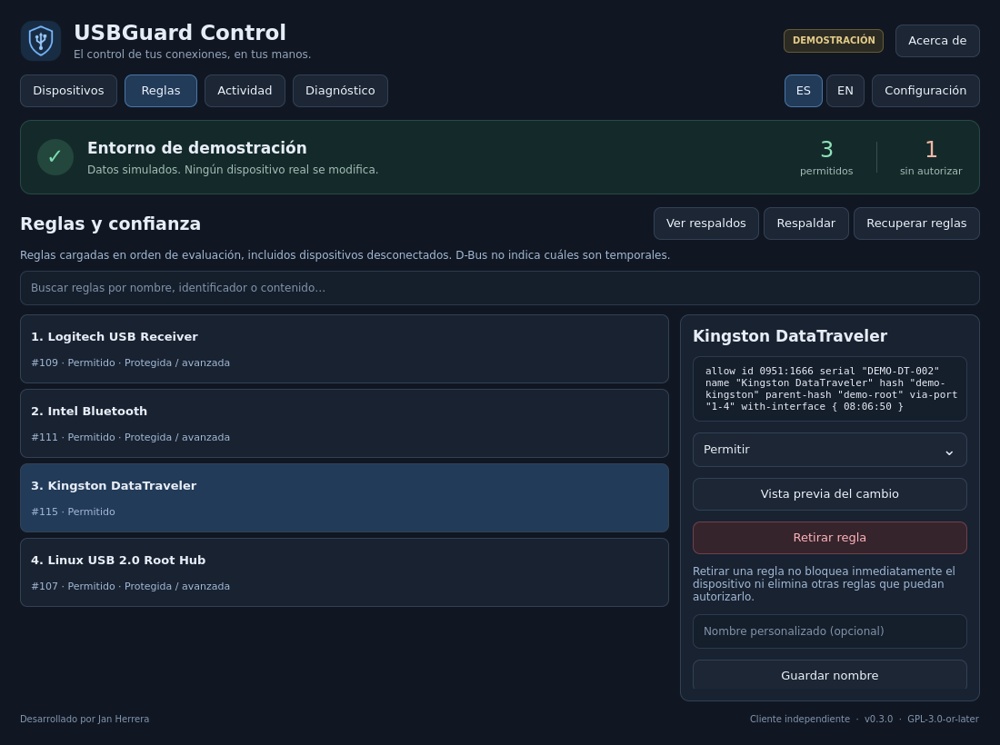
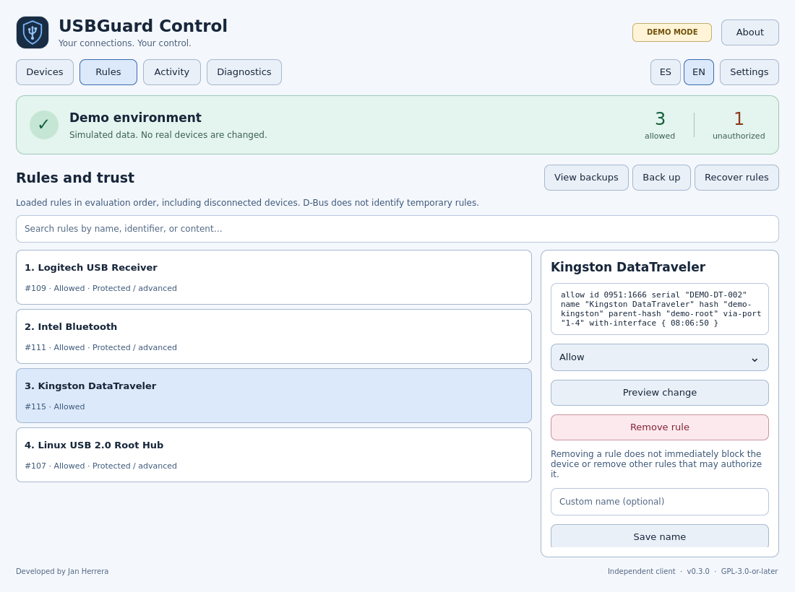
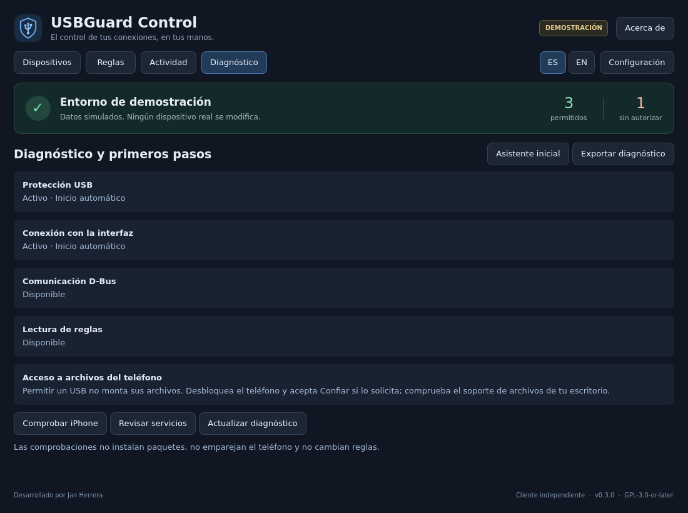

# Funciones de USBGuard Control 0.3.0

**Versión estable 0.3.0.** El alcance probado y sus límites están en [Validación 0.3.0](VALIDATION-0.3.es.md). La versión 0.2.0 se conserva como publicación anterior.

## Funciones implementadas

| Área | Comportamiento |
|---|---|
| Reglas y confianza | Lista ordenada, búsqueda, alias locales para dispositivos conectados o desconectados, contenido legible y detección de duplicados exactos |
| Edición guiada | Cambiar permitir/bloquear y retirar reglas específicas con huella e interfaces conocidas; vista previa de dispositivos coincidentes |
| Protección de entrada | Las reglas de HID, Bluetooth, concentradores y sintaxis avanzada quedan para consulta/revisión administrativa |
| Respaldos | Respaldo local obligatorio previo a editar; exportación JSON y apertura de la carpeta de respaldos |
| Recuperación | Añade como permanentes las reglas específicas faltantes al final; omite las protegidas/avanzadas y conserva las reglas existentes |
| Explicaciones | Origen observado por acción o señal de USBGuard; un origen desconocido se indica explícitamente |
| Dispositivos compuestos | Muestra varias funciones USB; los alias no cambian la identidad ni las reglas |
| Historial | SQLite local, 7/30/90 días de retención, máximo 10000 registros y vista de los 2000 últimos; búsqueda y fecha |
| Exportación | JSON o CSV del filtro actual, ocultación opcional de todos los detalles de eventos y neutralización de fórmulas en CSV |
| Diagnóstico | Estados de daemon/puente, lectura de reglas y orientación para acceso a archivos; validación opcional de emparejamiento iPhone sin modificarlo |
| Asistente inicial | Lista guiada de periféricos, recuperación, política y reconexión; conduce a Configuración tras revisión del usuario |
| Escritorio | Claro/oscuro/sistema, preferencias, alias y geometría persistentes; observador opcional al cerrar la ventana |
| Segundo plano | Instancia única, reapertura desde el menú y acción en notificaciones compatibles; bandeja opcional y arranque XDG de usuario desde el paquete instalado |

Todos los textos propios tienen catálogo español latinoamericano/inglés estadounidense. Los nombres del hardware no se traducen. `Ctrl+Q` termina el observador; la protección de USBGuard sigue independiente.

## Límites intencionales

- El editor es guiado, no un editor arbitrario de toda la gramática de USBGuard. Las reglas globales o con condiciones no se modifican desde esta versión.
- La recuperación no sustituye la política completa ni restaura opciones del daemon, unidades o permisos. Las reglas anteriores pueden ocultar las recuperadas. El respaldo representa reglas **cargadas**; D-Bus no distingue las temporales de las guardadas en disco.
- Una retirada de regla no modifica el estado actual de un dispositivo. Otra regla puede seguir autorizándolo. Las explicaciones no prometen identificar retrospectivamente el origen de todas las decisiones.
- Las escrituras D-Bus no son transacciones atómicas. Se comprueba la política antes de cada etapa y se informa de cambios parciales; queda una ventana de concurrencia propia de la API.
- El asistente acompaña la configuración, pero no instala paquetes, genera automáticamente reglas de confianza ni retira máscaras administrativas.
- El historial solo cubre eventos observados con la aplicación en ejecución. Los cierres normales se registran; después de una caída no se inventa una hora de cierre ni se reconstruyen eventos perdidos.
- El observador puede ejecutarse sin bandeja en GNOME. Las acciones de notificación dependen del servidor del escritorio. La entrada de inicio de sesión se ofrece para el paquete instalado, no para una ruta temporal de código fuente.
- Los respaldos contienen identificadores USB, se guardan con permisos privados y no se eliminan automáticamente. La opción de privacidad del historial oculta sus detalles completos, no solo las series.

## Capturas de demostración

## Validación

La suite automatizada incluye 91 pruebas de reglas, revalidación, denegación, cambios parciales, respaldos, recuperación selectiva, persistencia, privacidad, traducción e interfaz. `sh scripts/check.sh` ejecuta las pruebas, genera capturas de demostración y construye `dist/usbguard-control_0.3.0-1_all.deb`.

Las pruebas reales de escritorio, autenticación y ciclo de instalación se documentan en [Validación 0.3.0](VALIDATION-0.3.es.md). Las operaciones D-Bus se contrastaron con XML e implementación de USBGuard 1.1.4: el booleano de `appendRule` significa `temporary`, por lo que se envía `False` para persistir. También se verificaron contra USBGuard 1.1.3 en Parrot.

## English

Stable **0.3.0** adds guided rule management and selective recovery, local activity history, diagnostics, saved preferences, light/dark/system themes, and an optional single-instance background observer. Rules with advanced syntax or sensitive input interfaces remain read-only. The setup guide does not install packages or generate trusted policy automatically. Policy snapshots do not expose per-rule persistence; recovered rules are deliberately made permanent. Recovery preserves existing rules and connected-device authorization.

Edits and multi-rule recovery require multiple D-Bus operations and may request separate authentications. Canceling a later authentication can leave partial changes; the UI warns before confirmation, reports the failure, and retains a backup. It does not promise an atomic transaction or automatic rollback.

See the [validation report](VALIDATION-0.3.es.md) for actual desktop/VM coverage and limits. GNOME was tested from source without replacing the host package; Xfce and KDE were tested with the installed Debian package.
