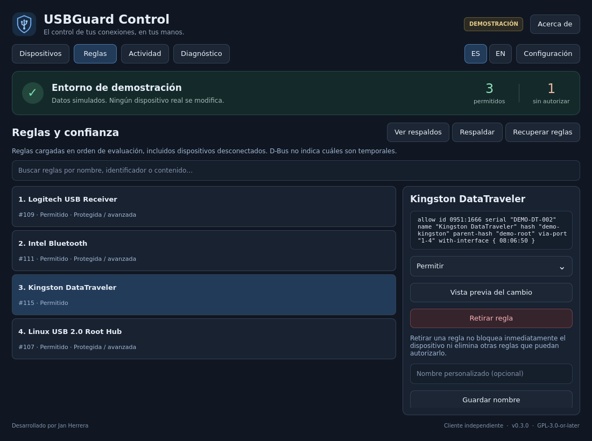
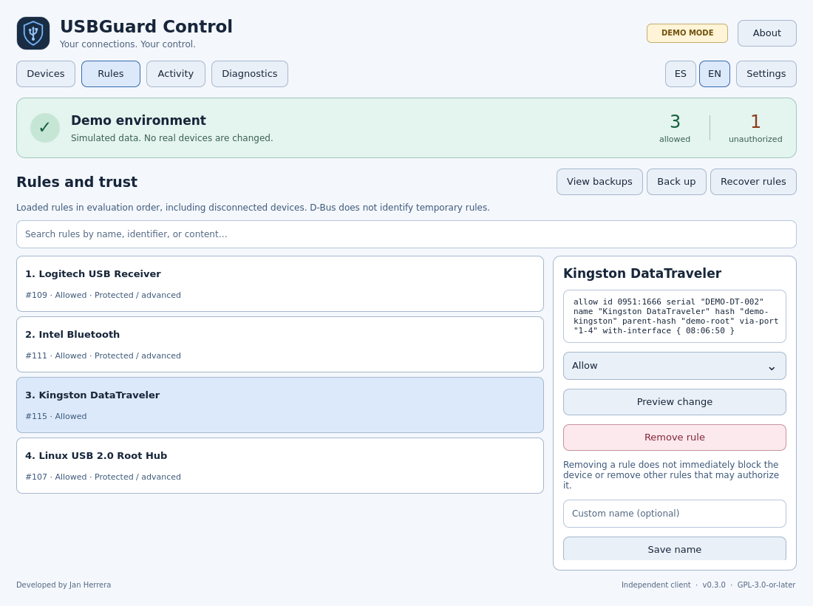
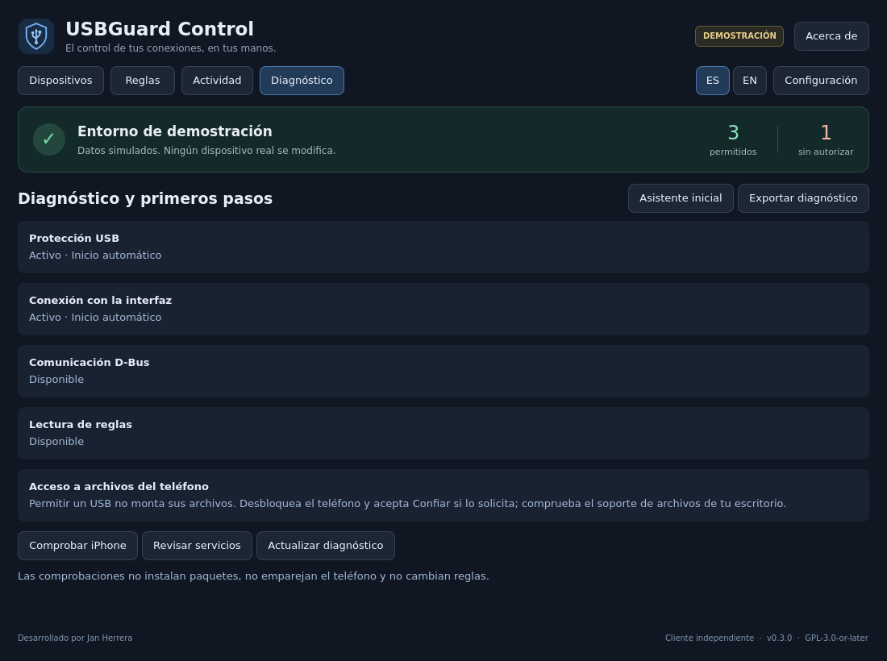

# Features of USBGuard Control 0.3.0

**Stable version 0.3.0.** The tested scope and its limits are in [Validation 0.3.0](VALIDATION-0.3.md). Version 0.2.0 is retained as a previous release.

## Functions implemented

| Area | Behavior |
|---|---|
| Rules and trust | Sorted list, search, local aliases for connected or disconnected devices, readable content and exact duplicate detection |
| Guided Editing | Change allow/block and remove specific rules with known fingerprint and interfaces; preview matching devices |
| Input-device protection | HID, Bluetooth, Hubs, and Advanced Syntax rules are for administrative review/consultation |
| Backups | Mandatory local backup prior to editing; JSON export and opening backup folder |
| Recovery | Add missing specific rules to the end as permanent; skip protected/advanced ones and keep existing rules |
| Explanations | Origin observed by USBGuard action or signal; an unknown origin is explicitly stated |
| Composite devices | Shows various USB functions; aliases do not change identity or rules |
| History | Local SQLite, 7/30/90 day retention, maximum 10000 records and view of last 2000; search and date |
| Export | JSON or CSV of the current filter, optional hiding of all event details and neutralization of formulas in CSV |
| Diagnosis | Daemon/bridge states, rule reading, and file access guidance; optional validation of iPhone pairing without modifying it |
| Initial assistant | Guided list of peripherals, recovery, policy and reconnection; leads to Configuration after user review |
| Desktop | Light/Dark/System, preferences, aliases and persistent geometry; optional observer when closing window |
| Background | Single instance, reopen from menu and action on notifications supported; optional tray and user XDG boot from installed package |

All application text has Latin American Spanish and American English translations. Hardware names are not translated. `Ctrl+Q` terminates the observer; USBGuard protection remains independent.

## Intentional limits

- The editor is guided, not an arbitrary editor of the entire USBGuard grammar. Global rules or rules with conditions are not modified from this version.
- Recovery does not replace the entire policy or restore daemon options, units, or permissions. Previous rules may shadow the retrieved ones. Backup represents **loaded** rules; D-Bus does not distinguish temporary ones from those saved on disk.
- A rule withdrawal does not modify the current state of a device. Another rule may still authorize it. Explanations do not promise to retrospectively identify the origin of all decisions.
- D-Bus writes are not atomic transactions. The policy is checked before each stage and partial changes are reported; There remains a concurrency window of the API.
- The wizard accompanies the configuration, but does not install packages, automatically generate trust rules or remove administrative masks.
- History only covers events observed with the application running. Normal closures are recorded; After a crash, no closing time is invented or lost events are reconstructed.
- Observer can run trayless in GNOME. Notification actions depend on the desktop server. The login entry is offered for the installed package, not for a temporary source code path.
- Backups contain USB identifiers, are saved with private permissions and are not automatically deleted. The history privacy option hides your complete details, not just serial numbers.

## Demo screenshots

## Validation

The automated suite includes 91 rule tests, revalidation, denial, partial changes, backups, selective recovery, persistence, privacy, translation and interface. `sh scripts/check.sh` runs the tests, generates demo screenshots, and builds `dist/usbguard-control_0.3.0-1_all.deb`.

Actual desktop testing, authentication, and installation cycle are documented in [Validation 0.3.0](VALIDATION-0.3.md). D-Bus operations were checked against XML and USBGuard 1.1.4 implementation: the boolean of `appendRule` means `temporary`, so `False` is sent to persist. They were also verified against USBGuard 1.1.3 on Parrot.

## Summary

Stable **0.3.0** adds guided rule management and selective recovery, local activity history, diagnostics, saved preferences, light/dark/system themes, and an optional single-instance background observer. Rules with advanced syntax or sensitive input interfaces remain read-only. The setup guide does not install packages or generate trusted policy automatically. Policy snapshots do not expose per-rule persistence; recovered rules are deliberately made permanent. Recovery preserves existing rules and connected-device authorization.

Edits and multi-rule recovery require multiple D-Bus operations and may request separate authentications. Canceling a later authentication can leave partial changes; the UI warns before confirmation, reports the failure, and retains a backup. It does not promise an atomic transaction or automatic rollback.

See the [validation report](VALIDATION-0.3.md) for actual desktop/VM coverage and limits. GNOME was tested from source without replacing the host package; Xfce and KDE were tested with the installed Debian package.
