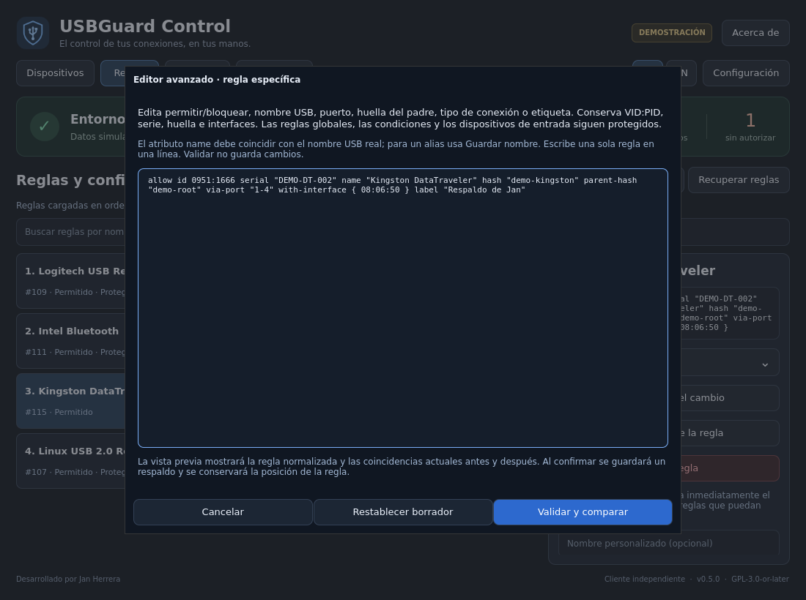

# USBGuard Control 0.5.0 — Rules Editor

Version **0.5.0** brings together history, diagnostics, background watcher, guided wizard, and backups from 0.3.0, and adds a **text editor for specific rules**. There is no need to install an intermediate version 0.4.0.

## Usage

1. Open **Rules** and select a specific editable rule.
2. Press **Edit rule text**. The draft retains the selected rule when you open it, even if the list changes selection or is updated.
3. Modify decision `allow`/`block`, `name`, `via-port`, `parent-hash`, `with-connect-type`, or `label`. Text values ​​have double quotes. `name` is the actual USB name; for a visual alias use **Save Name**.
4. Press **Validate and compare**. This stage does not write the policy. The format is normalized and the daemon is queried for the current matches of the previous rule and the proposed one.
5. Review both rules and matching devices. Canceling the comparison returns you to the draft. **Reset draft** restores the text with which the editor was opened.
6. Confirm the change and complete Polkit. A private backup is created and the position of the rule is preserved. The current USB authorization does not change; a reconnection reevaluates the policy.

## Editor limits

- VID:PID, serial-number presence and value, fingerprint and interfaces are preserved with respect to the original rule. It is not used to replace the identity of a device with another.
- Keeps rules for HID, Bluetooth, hubs and unknown interfaces protected. It also checks the current matching devices before writing.
- Does not support wildcards, conditions, multiple rules, `reject`, set operators other than exact/`equals`, or unknown syntax. It is an extension of the guided editor, not an unrestricted editor of all grammar.
- GNOME reserved tags are rejected. Control characters and malformed rules are not saved. The normalized format follows USBGuard serialization, including UTF-8 escaping and attribute ordering.
- The daemon validates the predicate during the match query. A valid preview does not guarantee that the rule store is writable: Polkit and USBGuard make the final decision when committing.
- A port restriction may no longer match when you move the device; removing that restriction expands the scope to other ports while preserving the fixed identity. Matches shown are only for currently connected devices.
- D-Bus policy and service owner are revalidated before writing. Editing requires adding the new rule and removing the old one: it is not atomic. A subsequent denial may leave partial changes, with notice and backup preserved.

The [official USBGuard language](https://usbguard.github.io/documentation/rule-language.html) has more capabilities than this editor. The serialization contract was checked against [RulePrivate.cpp](https://github.com/USBGuard/usbguard/blob/usbguard-1.1.4/src/Library/RulePrivate.cpp) and [Rule.hpp](https://github.com/USBGuard/usbguard/blob/usbguard-1.1.4/src/Library/public/usbguard/Rule.hpp). USBGuard credits are preserved; This interface is independent.

The initial wizard is still a guide: it does not automatically install the daemon or generate an unreviewed trusted list. Backups selectively recover specific rules; They do not replace the complete system configuration. See [inherited feature limits](FEATURES-0.3.md).

## Summary

Version **0.5.0** combines the history, diagnostics, background observer, setup guide and backups already available in 0.3.0 with a text editor for device-specific rules. No intermediate 0.4.0 installation is required.

Open **Rules → Edit rule text**, edit a single rule, then **Validate and compare**. The preview normalizes the text and queries the daemon for matches before/after without saving. Confirmation preserves rule order and saves a private backup before authenticated writes. Canceling the preview keeps the draft; Reset draft restores its original text.

The original VID:PID, serial, hash and interfaces remain fixed. Sensitive input/infrastructure, global rules, conditions, wildcards and unsupported grammar remain protected. Editable attributes include allow/block, USB name, port, parent hash, connection type and label. The USB name is a matching constraint, not a display alias. Matches cover currently connected devices only. Multiple D-Bus writes are not atomic; later authentication cancellation can leave partial changes. The setup guide does not automatically install or generate trusted rules, and recovery is selective rather than a complete system restore.
