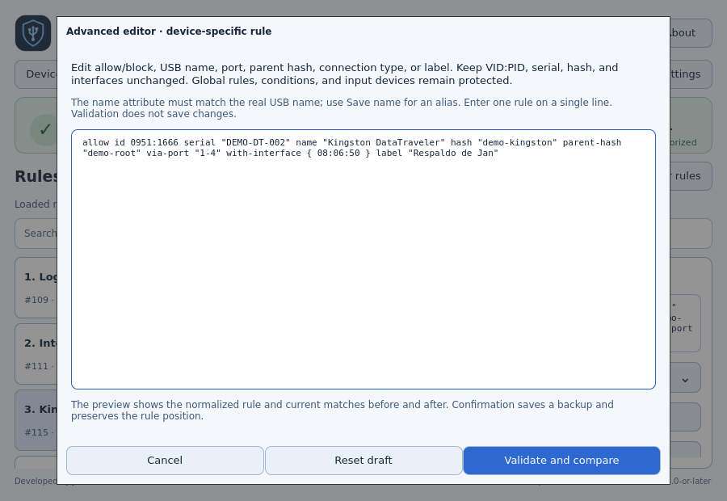

# USBGuard Control 0.5.0 — Editor de reglas

La versión **0.5.0** reúne historial, diagnóstico, observador en segundo plano, asistente guiado y respaldos de 0.3.0, y añade un **editor de texto para reglas específicas**. No hace falta instalar una versión intermedia 0.4.0.

## Uso

1. Abre **Reglas** y selecciona una regla específica editable.
2. Pulsa **Editar texto de la regla**. El borrador conserva la regla seleccionada al abrirlo, aunque la lista cambie de selección o se actualice.
3. Modifica la decisión `allow`/`block`, `name`, `via-port`, `parent-hash`, `with-connect-type` o `label`. Los valores de texto llevan comillas dobles. `name` es el nombre USB real; para un alias visual utiliza **Guardar nombre**.
4. Pulsa **Validar y comparar**. Esta etapa no escribe la política. Se normaliza el formato y se consulta al daemon por las coincidencias actuales de la regla anterior y de la propuesta.
5. Revisa ambas reglas y los dispositivos coincidentes. Cancelar la comparación devuelve al borrador. **Restablecer borrador** recupera el texto con el que se abrió el editor.
6. Confirma el cambio y completa Polkit. Se crea un respaldo privado y se conserva la posición de la regla. La autorización actual del USB no cambia; una reconexión reevalúa la política.

## Límites del editor

- VID:PID, presencia/valor de la serie, huella e interfaces se conservan respecto de la regla original. No sirve para sustituir la identidad de un dispositivo por otra.
- Mantiene protegidas las reglas de HID, Bluetooth, concentradores e interfaces desconocidas. También comprueba los dispositivos coincidentes actuales antes de escribir.
- No admite comodines, condiciones, varias reglas, `reject`, operadores de conjuntos distintos de exacto/`equals`, ni sintaxis desconocida. Es una ampliación del editor guiado, no un editor irrestricto de toda la gramática.
- Las etiquetas reservadas de GNOME se rechazan. Los caracteres de control y reglas mal formadas no se guardan. El formato normalizado sigue la serialización de USBGuard, incluidos escapes UTF-8 y orden de atributos.
- El daemon valida el predicado durante la consulta de coincidencias. Una vista previa válida no garantiza que el almacenamiento de reglas sea escribible: Polkit y USBGuard toman la decisión final al confirmar.
- Una restricción de puerto puede dejar de coincidir al mover el dispositivo; eliminar esa restricción amplía el alcance a otros puertos conservando la identidad fijada. Las coincidencias mostradas corresponden solo a dispositivos conectados en ese momento.
- Se revalida la política y el propietario D-Bus antes de escribir. La edición requiere añadir la regla nueva y retirar la anterior: no es atómica. Una denegación posterior puede dejar cambios parciales, con aviso y respaldo conservado.

El [lenguaje oficial de USBGuard](https://usbguard.github.io/documentation/rule-language.html) tiene más posibilidades que este editor. El contrato de serialización se contrastó con [RulePrivate.cpp](https://github.com/USBGuard/usbguard/blob/usbguard-1.1.4/src/Library/RulePrivate.cpp) y [Rule.hpp](https://github.com/USBGuard/usbguard/blob/usbguard-1.1.4/src/Library/public/usbguard/Rule.hpp). Se conservan los créditos de USBGuard; esta interfaz es independiente.

El asistente inicial sigue siendo una guía: no instala automáticamente el daemon ni genera una lista de confianza sin revisión. Los respaldos recuperan selectivamente reglas específicas; no sustituyen la configuración completa del sistema. Consulta los [límites de las funciones heredadas](FEATURES-0.3.md).

## English

Version **0.5.0** combines the history, diagnostics, background observer, setup guide and backups already available in 0.3.0 with a text editor for device-specific rules. No intermediate 0.4.0 installation is required.

Open **Rules → Edit rule text**, edit a single rule, then **Validate and compare**. The preview normalizes the text and queries the daemon for matches before/after without saving. Confirmation preserves rule order and saves a private backup before authenticated writes. Canceling the preview keeps the draft; Reset draft restores its original text.

The original VID:PID, serial, hash and interfaces remain fixed. Sensitive input/infrastructure, global rules, conditions, wildcards and unsupported grammar remain protected. Editable attributes include allow/block, USB name, port, parent hash, connection type and label. The USB name is a matching constraint, not a display alias. Matches cover currently connected devices only. Multiple D-Bus writes are not atomic; later authentication cancellation can leave partial changes. The setup guide does not automatically install or generate trusted rules, and recovery is selective rather than a complete system restore.
